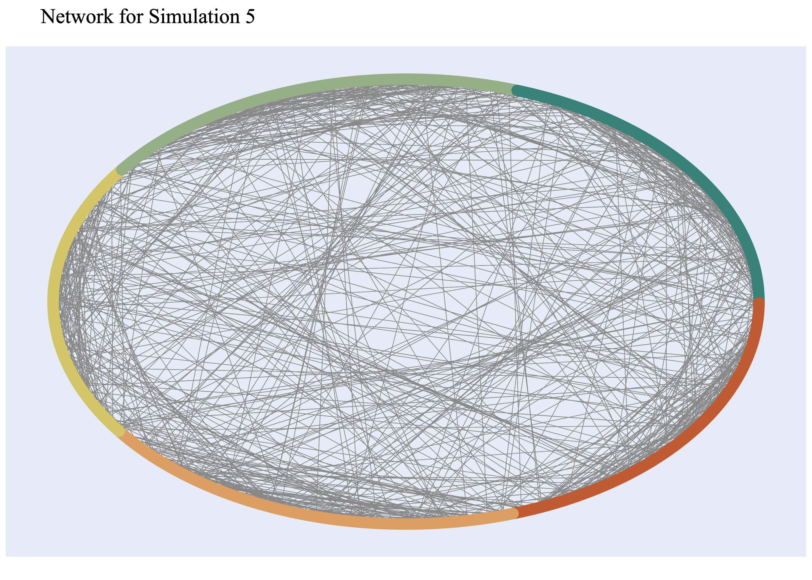
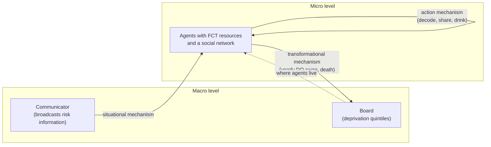

# Fundamental Cause Theory and the Alcohol Harm Paradox

An agent-based model of whether **Fundamental Cause Theory (FCT)** can explain the **Alcohol Harm Paradox (AHP)**. It started as my MEng final-year project at the University of Sheffield (Automatic Control & Systems Engineering, 2023), supervised by Prof. Robin Purshouse.

**[Try it in your browser](https://sebzuddas.github.io/FCT_Python/)** (no install, runs locally in the page) · [Dissertation (PDF)](docs/dissertation.pdf) · [Slides](docs/presentation.pptx)

<p align="center">
  
</p>

## The idea

- **Alcohol Harm Paradox.** People with lower socioeconomic status suffer more alcohol-related harm across their lives than wealthier people, even when drinking the same amount or less.
- **Fundamental Cause Theory.** Socioeconomic resources (education, wealth, power, prestige) are flexible and protect against risk whatever the disease, so inequality in health persists even as individual risk factors change.
- **The question.** If agents differ only in these resources, does the AHP emerge? The model looks for three signs across deprivation quintiles DQ1 (least deprived) to DQ5 (most deprived). With γ as the least-squares slope against quintile:
  1. γ₁ > 0: more deaths in more deprived quintiles
  2. γ₂ < 0: a lower share of successful adaptations in more deprived quintiles
  3. γ₃ < 0: less average drinking in more deprived quintiles

**Result.** Across 200 Latin-hypercube simulations the signature appeared once (Experiment Set 2, Simulation 5), and it vanished when that run was extended from 520 to 1,200 weeks. So FCT, as implemented, does not reliably produce the AHP. See Chapters 5 and 6 of the dissertation.

## Repository layout

| Path | What it is |
|---|---|
| [web/](web/) | Static browser app (vanilla JS, no build step), a JavaScript port of the model. Deployed to GitHub Pages. |
| [FCT_Model/](FCT_Model/) | The original Python model on [Repast4Py](https://repast.github.io/repast4py.site/). `core/` holds the reusable MBSSM base classes. |
| [Experiment_Generator/](Experiment_Generator/) | Latin Hypercube sampling of the parameter space into YAML files. |
| [Data_Processing/](Data_Processing/) | Loads results into MySQL, computes the three gradients, and builds Plotly/Dash views. |
| [runModel.py](runModel.py) | Command-line front end for running, sampling and analysing. |
| [docs/](docs/) | Dissertation, slides, result plots and animations. |

## Mechanism-Based Social Systems Modelling

The model follows the MBSSM architecture of Vu et al., which builds on Coleman's boat. One tick is one week.



1. **Situational.** The communicator sends a random 5-bit event to a random subset of agents. The event's decimal value is the resources needed to act on it.
2. **Action.** Each agent tries to decode one pending event: it succeeds if knowledge + wealth + prestige + power covers the value. Agents pass solved events to network neighbours, then drink, which determines absolute risk ρ(c) = 100·β·(c − 0.5).
3. **Transformational.** Yearly, agents swap deprivation quintiles in matched pairs (after Giorgi et al.), age by one year, and die if modified risk exceeds a threshold. Death resets age to 18.

Two risk functions were compared: the **original** (Experiment Set 1) scales risk by the share of unsolved events, and the **modified** one (Experiment Set 2) rewards a high solved ratio. Both are selectable in the web app.

## Run the web app

```bash
python3 -m http.server -d web 8000     # then open http://localhost:8000
npm test                               # model tests (Node 20+)
```

Add `?embed=1` to the URL to hide the page chrome for embedding, for example on a personal site:

```html
<iframe src="https://sebzuddas.github.io/FCT_Python/?embed=1" title="FCT simulator"
        style="width:100%;height:1500px;border:0" loading="lazy"></iframe>
```

### Deploying to GitHub Pages

[.github/workflows/pages.yml](.github/workflows/pages.yml) runs the tests and publishes `web/` on every push to `main` that touches it. One-time setup: in the repo go to **Settings → Pages → Build and deployment → Source: GitHub Actions**.

### Differences from the Python model

The port is a faithful re-implementation of the mechanisms, not a bit-for-bit replay, because the random-number generators differ. Deliberate differences:

- Deaths are reported as raw event counts. The dissertation's plotted totals sum a cumulative counter, so magnitudes differ; compare the signs of γ.
- The homophilous network is built directly (same quintile, within five years of age) rather than by rejection sampling.
- A per-agent RNG that was re-seeded identically inside the Python action loop is replaced by one shared stream.

Quirks of the Python code that the port keeps on purpose: adaptation costs do not carry across weeks, a neighbour that has solved nothing cannot receive a peer's event, swapping depends on quintile only (not age, as the text describes), and yearly events fire on weeks 1, 53, 105 and so on.

## Run the Python model

Requires Python 3.10+ and an MPI installation.

```bash
brew install open-mpi                       # or apt install libopenmpi-dev
python3 -m venv .venv && source .venv/bin/activate
CC=mpicc CXX=mpicxx pip install -r requirements.txt

python runModel.py run --years 10           # run the model for ten simulated years
python runModel.py experiments --lhs 100    # generate 100 Latin-hypercube parameter files
python runModel.py experiments --all        # run every generated parameter file
```

Run these from the repository root. The data-analysis commands (`data`, `find`, `show`) additionally need a local MySQL database and the `MYSQL_USER` / `MYSQL_PASSWORD` environment variables; see [Data_Processing/](Data_Processing/).

Parameters live in [FCT_Model/props/model/](FCT_Model/props/model/). The exact YAML files for Simulations 5 and 70 are in Appendices E and F of the dissertation.

## Known limitations

- The Python entry points use relative paths and must be launched from the repository root.
- There is no automated test coverage for the Python model; `Unit_Tests/` only holds a placeholder. The JavaScript port has tests in `web/test/`.
- Resources are static apart from knowledge, and quintile swaps do not change an agent's FCT resources, so the "resources follow deprivation" link weakens over time. This is a plausible contributor to the AHP not appearing reliably, but I have not tested it.

## Citation

> Zuddas, S. (2023). *Complex Systems Modelling of Alcohol-related Health Inequalities*. MEng dissertation, Department of Automatic Control & Systems Engineering, University of Sheffield.

The model builds on Boyd (2023) and the MBSSM framework of Vu et al.; full references are in the dissertation.
